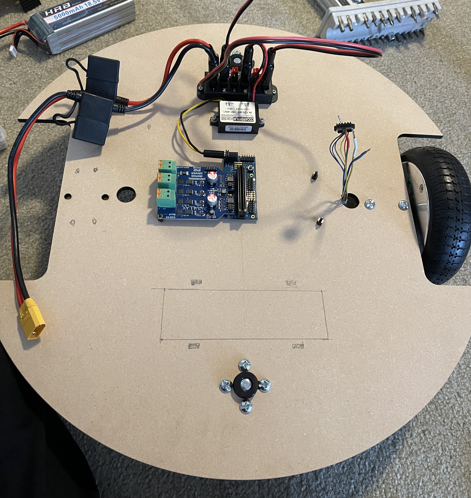
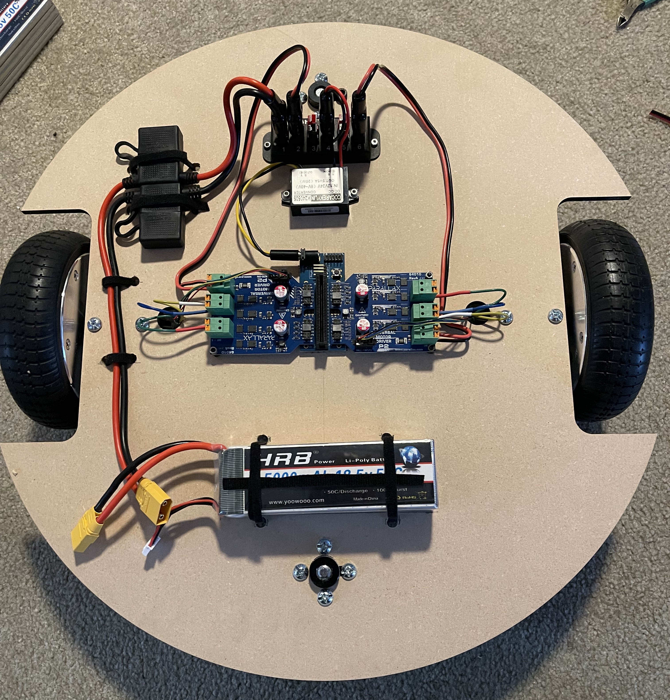
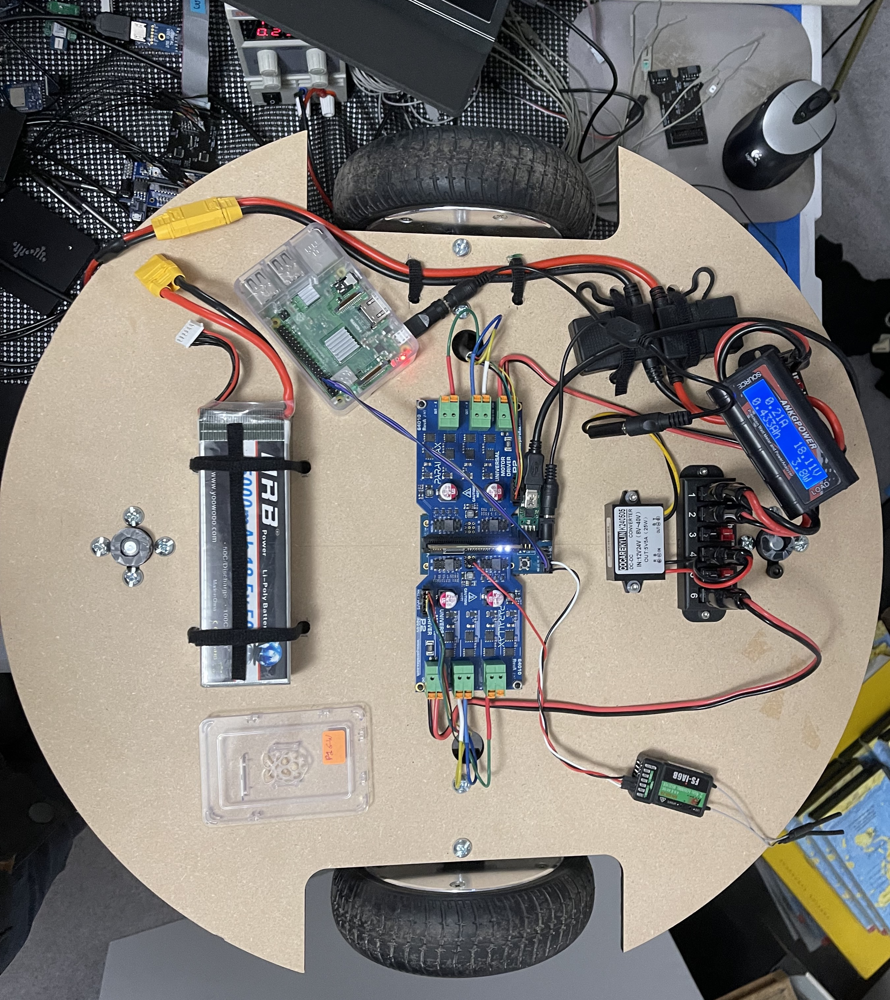

# P2-BLDC-Motor-Control - The Author's Test Platform

The test platform I use as I work on these drivers, and how it is set up.

![Project Maintenance][maintenance-shield]

[![License][license-shield]](LICENSE)

## Table of Contents

On this Page:

- [Videos of my Platform](#videos-of-my-platform) - the platform under RPi and FlySky control
- [Images of my Platform](#images-of-my-platform) - unboxing, assembly, parts and the finished platform
- [The FlySky Connection](#the-flysky-connection) - SBus receiver wiring to the P2

Additional pages:

- [Main Page](README.md) - Return to the top of this repo
- [Drawings](DRAWINGS.md) - Files (.dwg) that you can use to order your own platform
- [Serial Control](SERIAL-CONTROL.md) - driving the platform from a Raspberry Pi

---

As I work on these Parallax Propeller 2 (P2) drivers I need a test platform. This page describes what my platform looks like and how it is set up.

## Videos of my Platform

The video of this platform driven from an RPi is on the [Serial Control page](SERIAL-CONTROL.md).

Earlier video of the [Platform under FlySky R/C control](https://youtu.be/EeIrPzJ0THU) @ YouTube

## Images of my Platform

I decided to use the inset wheels design (See [Drawings](DRAWINGS.md)) for mine and ordered it from [SendCutSend.com](https://sendcutsend.com/). I ordered a bunch of the spacers too. The order arrived like this:

**Figure 1**: *The platform order as it arrived*

You can see there are a number of predrilled holes for screws, castors, and cable feed through for the motor cables:

- The 4 center small holes (for M3 screws) are for mounting the twin motor boards connected to the Mini Edge Breakout Board.
- 2 ea. holes for each motor (for 1/4" - 20 Screws.)
- 2x - 4 ea. holes for each castor - (for 1/4" - 20 Screws.)
- 2x - 2 ea. holes for each spacer board (shim) (for 1/4" - 20 Screws.)

---

After unboxing the parts need to be mounted:

**Figure 2**: *The platform during assembly*

The pencil marks show where I drilled additional holes as I determined what additional parts I needed to mount.

---

The finished platform looks like this:

**Figure 3**: *The finished platform*

Here are links to key parts I used:

- [HRB 5S 18.5V 5000mAh 50-100C RC Lipo Battery](https://www.amazon.com/HRB-5000mAh-50-100C-Battery-T-REX550/dp/B06XP7TY3S) - Amazon
- [6-Position 45A Power Pole Distribution Block](https://www.amazon.com/Chunzehui-6-Position-Distribution-Connector-Distributor/dp/B07KQD9V3G) - Amazon
- [DC 12v 24v to 5v Step Down Converter Regulator 5A 25W](https://www.amazon.com/Converter-Regulator-Adapter-Reducer-Electronics/dp/B07Q5W1BG3) - Amazon - Added Anderson power-pole connector on input side and N barrel plug on output side.
- [150A Power Analyzer, High Precision RC with Digital LCD Screen](https://www.amazon.com/ANKG-Precision-Measurement-Connectors-connected/dp/B07YF393ZH) - Amazon, LCD screen shows V, A, W, Ah, Wh measurements
- [Inline Blade-Fuse Holders](https://www.amazon.com/iGreely-Terminals-Connectors-Automotive-Compatible/dp/B07ST82H9H) - Amazon, Replaced ring-terminal ends with XT90 socket to mate with battery

**NOTE:** *Castors: the set screws tend to come loose with vibration. I was driving on gravel. So use Loctite or something similar to hold them in place if you don't want castors falling off as you are driving.*

---

And here I'm running tests of the FlySky remote control demo. (Of course, running on the test-bench required an empty Amazon box. ;-)

**Figure 4**: *Driving with the FlySky remote*

### The FlySky Connection

*I used the* **Parallax 64019 P2 Edge Mini Breakout Board** *for my Platform. I chose pin 58 for SBus receive.*

The SBus receive pin and how to change it: see [Wiring the FlySky Connection](README.md#wiring-the-flysky-connection) in the README.

**P2 Wiring for SBus Receiver:**

| P2 pin | SBus receiver | Purpose |
| --- | --- | --- |
| GND | GND | Signal ground |
| Vcc | Vcc | 5v Power for the Receiver |
| 58 | Rx | Data from SBus Rcvr to the P2 |

**NOTE:** *With the dual BLDC motor boards occupying most of the pins, finding 5v was challenging. I ended up soldering in a pin between the two headers, routing 5v to it and then connecting the SBus Rcvr Vcc to this pin.*

---

Here's an updated bench setup with the RPi in the driver's seat!

**Figure 5**: *The platform with the RPi in the driver's seat*

**NOTE:** *The DC step-down supply was chosen so that I can power the P2 as well as the RPi from the same 5v. This picture shows me using a Y-splitter on the 5v with the two legs then feeding the P2 and the RPi.*

---

> If you like my work and/or this has helped you in some way then feel free to help me out for a couple of :coffee:'s or :pizza: slices!
>
>  &nbsp;&nbsp; -OR- &nbsp;&nbsp; [Patreon.com/IronSheep](https://www.patreon.com/IronSheep?fan_landing=true)

---

## How to Contribute

This is a project supporting our P2 Development Community. Please feel free to contribute to this project. You can contribute in the following ways:

- File **Feature Requests** or **Issues** (describing things you are seeing while using our code) at the [Project Issue Tracking Page](https://github.com/ironsheep/P2-BLDC-Motor-Control/issues)
- Fork this repo and then add your code to it. Finally, create a Pull Request to contribute your code back to this repository for inclusion with the projects code. See [CONTRIBUTING](CONTRIBUTING.md)

---

## Disclaimer and Legal

> *Parallax, Propeller Spin, and the Parallax and Propeller Hat logos* are trademarks of Parallax Inc., dba Parallax Semiconductor

---

## License

Licensed under the MIT License.

Follow these links for more information:

### [Copyright](copyright) | [License](LICENSE)

[maintenance-shield]: https://img.shields.io/badge/maintainer-stephen%40ironsheep%2ebiz-blue.svg?style=for-the-badge

[license-shield]: https://img.shields.io/badge/License-MIT-yellow.svg
