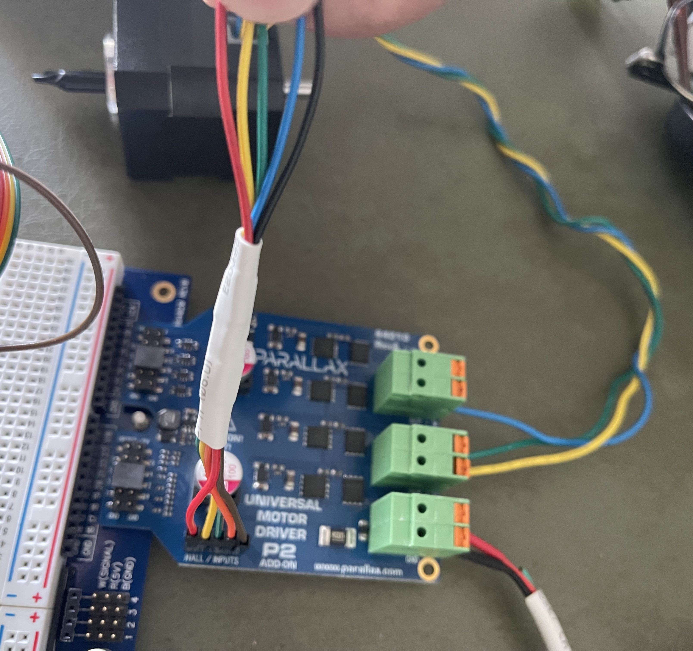
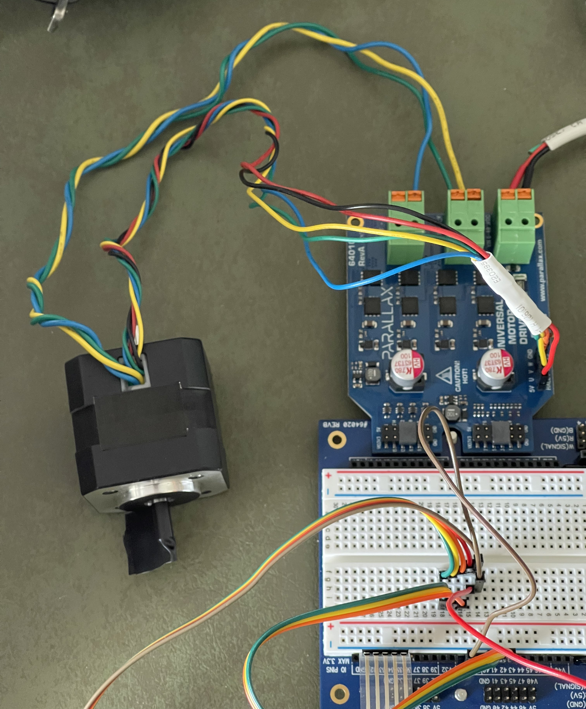

# P2-BLDC-Motor-Control - Connecting the DocoEng Motor

Wire the DocoEng 4,000 RPM BLDC motor to the Parallax 64010 Universal Motor Driver P2 Add-on Board.

![Project Maintenance][maintenance-shield]

[![License][license-shield]](LICENSE)

## Table of Contents

On this Page:

- [Specs of the DocoEng Motor](#specs-of-the-docoeng-motor) - geometry, hall order and the maker's data sheet figures
- [Cabling of the DocoEng Motor](#cabling-of-the-docoeng-motor) - which wire goes where
- [How to Contribute](#how-to-contribute) - help improve this project

Additional pages:

- [Main Page](README.md) - Return to the top of this repo
- [DocoEng Technical Manual](MOTOR-DOCO-TECHNICAL-MANUAL.md) - how the motor behaves on the driver: hall sectors, timing, speed range and what we measured
- [Configuring the driver for your motor](MOTOR_CHOICE.md) - select the motor and drive voltage
- [Adding support for a new motor](ADDING_MOTOR.md) - the same wiring table, as step 1 of adding a motor

## Specs of the DocoEng Motor

The DocoEng motor we support:

| Category | Value | Description |
| --- | --- | --- |
| **DocoEng 4k RPM 24V motor** || the Parallax small motor
| Hall ticks per revolution | 24 ticks | verified on our hardware (turned by hand, against a shaft encoder)
| Degrees per hall tick | 15 degrees | on average; the six hall sectors are not equal: on our two motors they measure 13.4° to 16.9°, and each repeats every turn
| Ticks per hall-cycle | 6 ticks | positive power (ticks rising): 1-5-4-6-2-3 negative power (ticks falling): 1-3-2-6-4-5 the falling order verified on our hardware
| Hall-cycles per revolution | 4 hall-cycles | verified on our hardware
| Degrees per hall-cycle | 90 degrees | verified on our hardware
| Magnets	| 8 poles | verified on our hardware (4 pole pairs)
| **From the maker's data sheet** || [DOCOMotor.pdf](./DOCs/DOCOMotor.pdf)
| Nominal voltage | 24 V DC |
| Phase-to-phase resistance | 1.8 Ω |
| No-load speed | 6,800 RPM ±10% | at 24 V
| No-load current | 0.4 A max |
| Rated speed | 4,000 RPM ±10% |
| Rated torque | 0.0625 N·m | about 1.84 A, by the torque constant
| Output power | 26 W |
| Back-EMF constant | 3.53 V per 1,000 RPM |
| Torque constant | 0.034 N·m/A |
| Insulation class | B |
| Rotation | clockwise, viewed from the output shaft | the output shaft is the one with the raised round boss; turning the motor this way counts the halls up (verified on our hardware)
| Hall sensor supply | +5 to +20 V DC | three sensors, Hu Hv Hw, on the yellow, green and blue leads
| Shaft | 5 mm, out of both ends |

## Cabling of the DocoEng Motor

This page connects the DocoEng.com BLDC motor (4,000 RPM, 24V) to the driver. The motor [specifications are here](./DOCs/DOCOMotor.pdf). These are the connections I used. I ended up cutting off the end of some female connector wires and soldering them to the motor wires to make a connector. While most of us would simply solder on connectors, I was on a road trip and this is what I had access to. ;-)

| Wire Color | Purpose | Adapter Wire Color | board Connector |
| --- | --- | --- | --- |
| **Hall Sensor Wires** | | *- 26 AWG wires (thinner) -*
| Red | +5V Hall Pwr | adapt Red | Hall IN: +v
| Yellow | Hall U | adapt Yellow | Hall IN: U
| Green | Hall V | adapt Green  | Hall IN: V
| Blue | Hall W | adapt Orange  | Hall IN: W
| Black | Ground | adapt Brown  | Hall IN: GND
| **Motor Drive Wires** | | *- 20 AWG wires -*
| Yellow | Phase U | -no adapter- | Motor out U
| Green | Phase V | -no adapter- | Motor out V
| Blue | Phase W | -no adapter- | Motor out W

**Figure 1**: *This is the cabling per the table above.*

**Figure 2**: *The motor hooked up.*

**NOTE:** *the electrical tape "flag" lets me tell the relative position of the shaft during movement.*

Once the cabling of your motor is completed, you are ready to [configure your driver](MOTOR_CHOICE.md) then run the code.

Enjoy!

*Stephen*

---

## How to Contribute

This is a project supporting our P2 Development Community. Please feel free to contribute to this project. You can contribute in the following ways:

- File **Feature Requests** or **Issues** (describing things you are seeing while using our code) at the [Project Issue Tracking Page](https://github.com/ironsheep/P2-BLDC-Motor-Control/issues)
- Fork this repo and then add your code to it. Finally, create a Pull Request to contribute your code back to this repository for inclusion with the projects code. See [CONTRIBUTING](CONTRIBUTING.md)

---

> If you like my work and/or this has helped you in some way then feel free to help me out for a couple of :coffee:'s or :pizza: slices!
>
>  &nbsp;&nbsp; -OR- &nbsp;&nbsp; [Patreon.com/IronSheep](https://www.patreon.com/IronSheep?fan_landing=true)

---

## Disclaimer and Legal

> *Parallax, Propeller Spin, and the Parallax and Propeller Hat logos* are trademarks of Parallax Inc., dba Parallax Semiconductor

---

## License

Licensed under the MIT License.

Follow these links for more information:

### [Copyright](copyright) | [License](LICENSE)

[maintenance-shield]: https://img.shields.io/badge/maintainer-stephen%40ironsheep%2ebiz-blue.svg?style=for-the-badge

[license-shield]: https://img.shields.io/badge/License-MIT-yellow.svg
