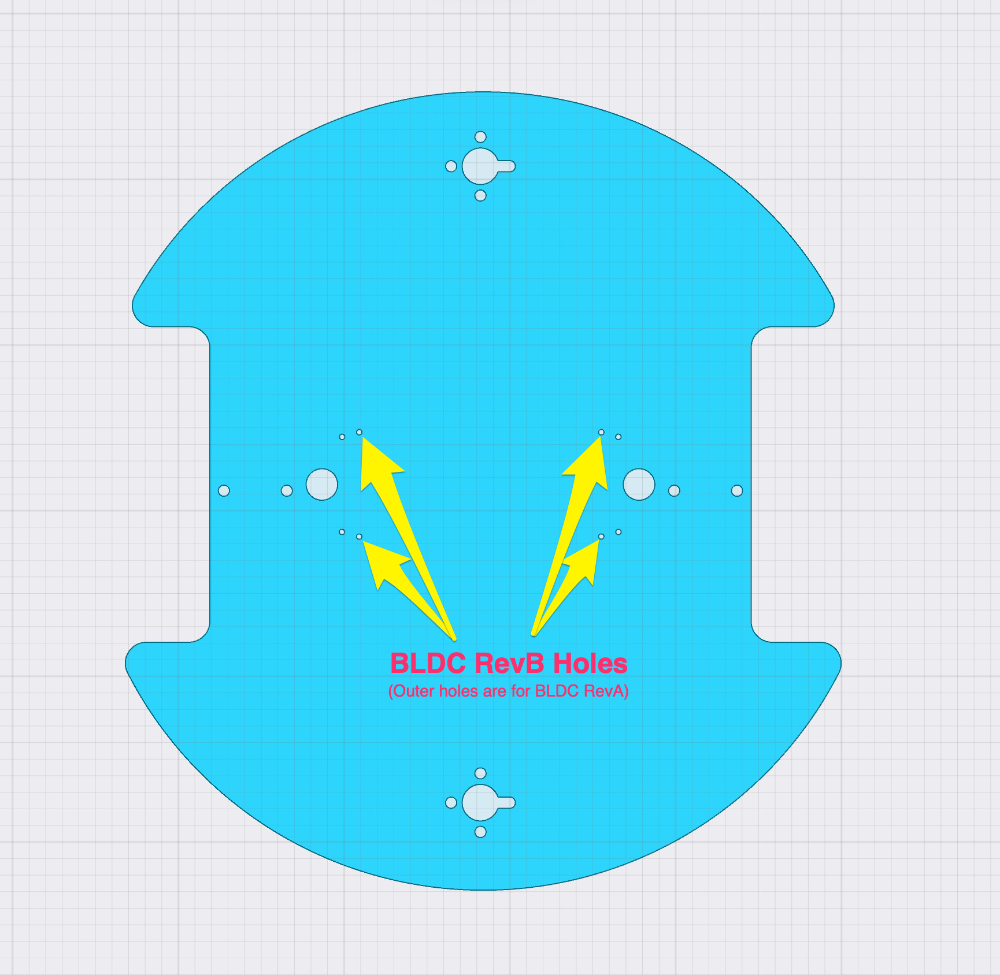
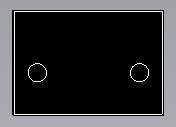
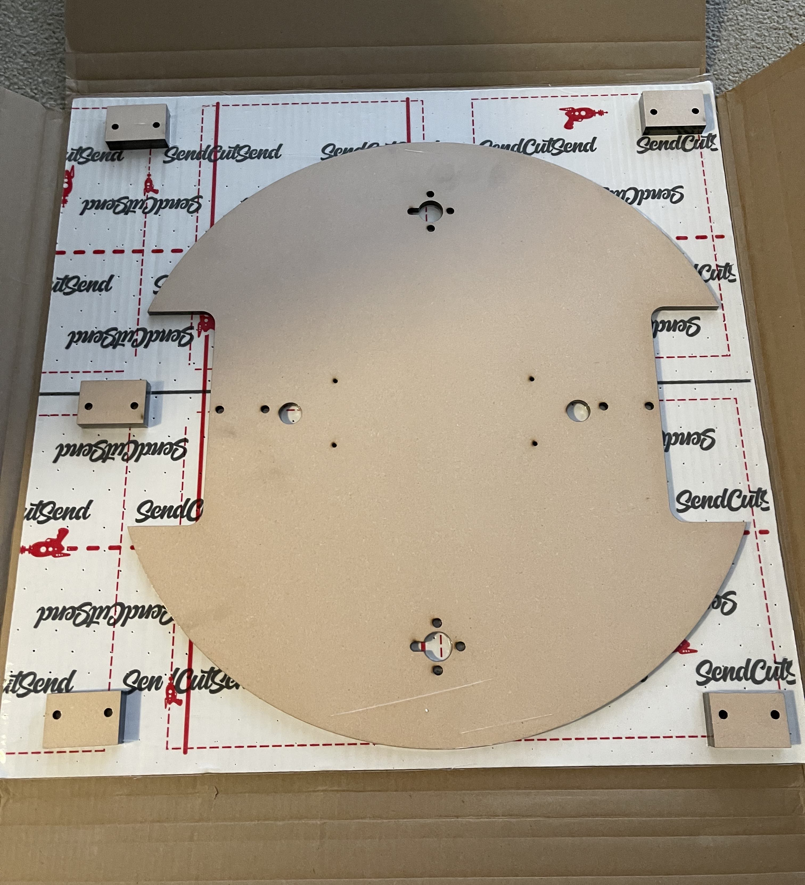
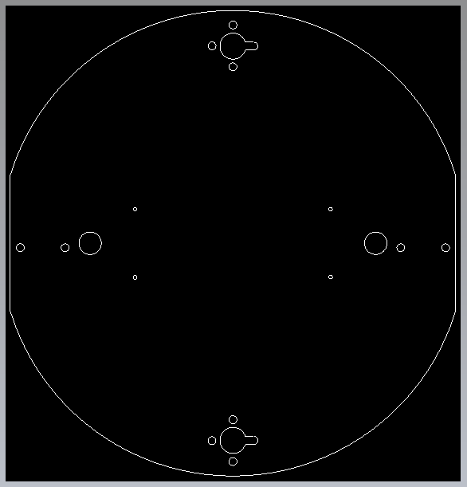
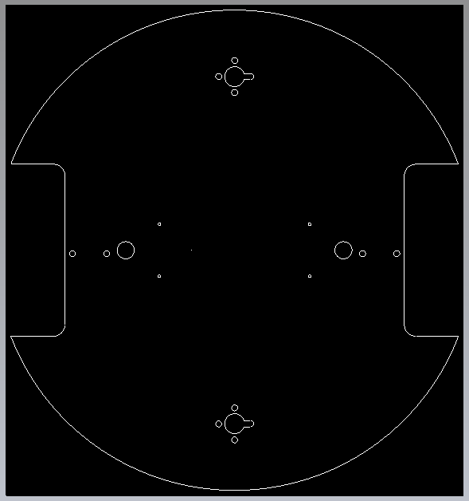

# P2-BLDC-Motor-Control - Platform Drawings

Drawing files you can send to a laser-cutting service to make your own two-wheel drive platform inexpensively.

![Project Maintenance][maintenance-shield]

[![License][license-shield]](LICENSE)

## Table of Contents

On this Page:

- [Drawing Files](#drawing-files) - the platform board and the spacer board
- [Packaging (order arrives)](#packaging-order-arrives) - what my order looked like when it arrived
- [Older Drawing Files](#older-drawing-files) - my earlier designs

Additional pages:

- [Main Page](README.md) - Return to the top of this repo
- [Start Your Own Drive Project](DEVELOP.md) - add the drive objects to your project
- [The Author's Test Platform](AUTHORS-Platform.md) - the platform I built from these drawings

## Drawing Files

These are the two design files I sent off to be made by [SendCutSend.com](https://sendcutsend.com/). Their prices are quite good!

### 1. Platform Board

[Drawing File - outboard wheels (.dwg)](DOCs/DesignFiles/EdgeMiniRoundV3b.dwg) - I spec'd 0.250" MDF as the material at ~$29 USD.

**Figure 1**: *The platform board with outboard wheels*

**NOTE:** *The 8 center small holes (for M3 screws) are for mounting the twin motor boards connected to the Parallax 64019 P2 Edge Mini Breakout Board or the newer Parallax 64029 P2 Edge Breakout Board. The inner-most 4 holes are for the new, smaller Rev B boards, while the outer four are for the larger Rev A motor boards.*

There are 2 ea. holes for each motor (for 1/4" - 20 Screws.)

There are 4 ea. holes for each castor - (for 1/4" - 20 Screws.) One of the castor holes is longer to provide access to the hex nut.

### 2. Spacer Board

[Drawing File - spacer to drop motors below castors (.dwg)](DOCs/DesignFiles/SpacerV1.dwg) - I spec'd 0.025" MDF as the material with ten of these for ~$14.20 USD.

**Figure 2**: *The spacer board*

There are 2 ea. holes for each spacer board (shim) (for 1/4" - 20 Screws.)

## Packaging (order arrives)

This is what I found when I opened my order:

**Figure 3**: *The order as it arrived*

The package arrived with these contents. This was quite well packaged. The MDF part was shrink-wrapped to the backing cardboard. The laser cuts were all clean with a little bit of scorch mark on one side of the MDF as you might expect.

## Older Drawing Files

These are my earlier designs, which the current platform board above replaces.

1. **OLD:** [Drawing File - outboard wheels (.dwg)](DOCs/DesignFiles/EdgeMiniRoundV1.dwg) - I spec'd 0.250" MDF as the material at ~$29 USD.

    

    **Figure 4**: *The earlier outboard-wheels design*

1. **OLD:** [Drawing File - enclosed wheels (.dwg)](DOCs/DesignFiles/EdgeMiniRoundV2_encl.dwg) - I spec'd 0.250" MDF as the material at ~$29 USD.

    

    **Figure 5**: *The earlier enclosed-wheels design*

## How to Contribute

This is a project supporting our P2 Development Community. Please feel free to contribute to this project. You can contribute in the following ways:

- File **Feature Requests** or **Issues** (describing things you are seeing while using our code) at the [Project Issue Tracking Page](https://github.com/ironsheep/P2-BLDC-Motor-Control/issues)
- Fork this repo and then add your code to it. Finally, create a Pull Request to contribute your code back to this repository for inclusion with the projects code. See [CONTRIBUTING](CONTRIBUTING.md)

---

> If you like my work and/or this has helped you in some way then feel free to help me out for a couple of :coffee:'s or :pizza: slices!
>
>  &nbsp;&nbsp; -OR- &nbsp;&nbsp; [Patreon.com/IronSheep](https://www.patreon.com/IronSheep?fan_landing=true)

---

## Disclaimer and Legal

> *Parallax, Propeller Spin, and the Parallax and Propeller Hat logos* are trademarks of Parallax Inc., dba Parallax Semiconductor

---

## License

Licensed under the MIT License.

Follow these links for more information:

### [Copyright](copyright) | [License](LICENSE)

[maintenance-shield]: https://img.shields.io/badge/maintainer-stephen%40ironsheep%2ebiz-blue.svg?style=for-the-badge

[license-shield]: https://img.shields.io/badge/License-MIT-yellow.svg
