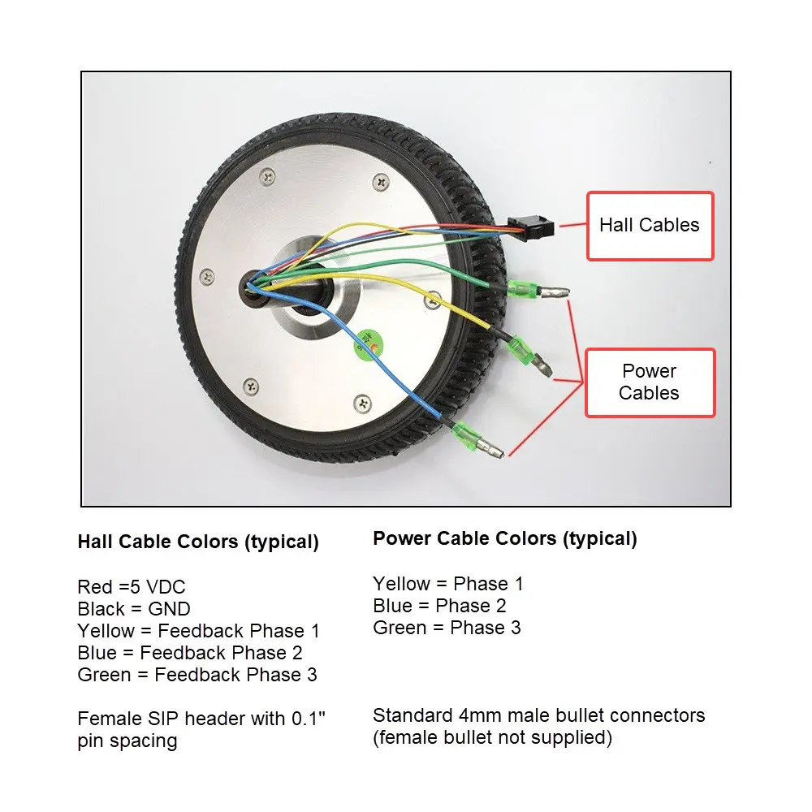
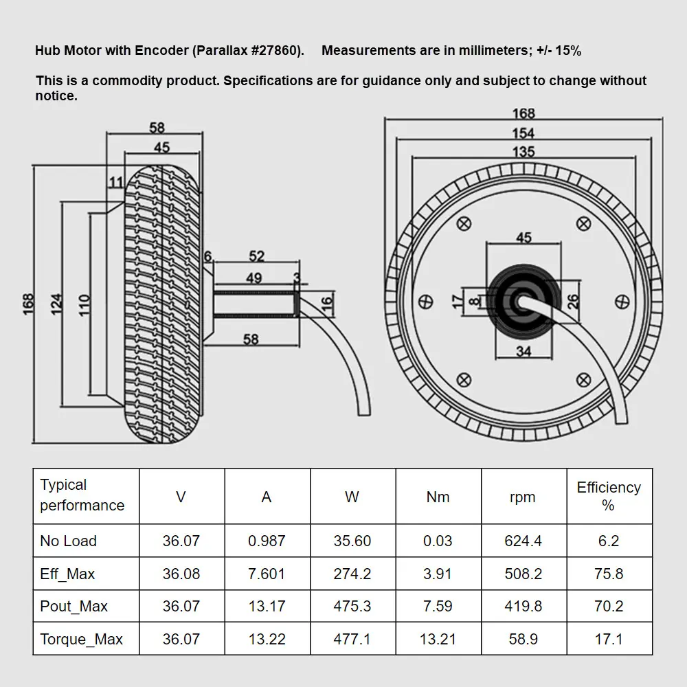
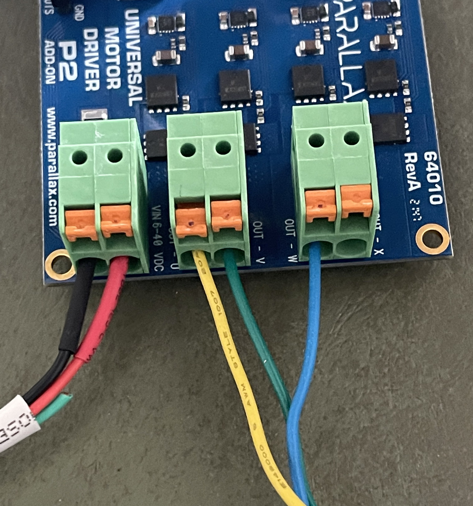

# P2-BLDC-Motor-Control - Connecting the 6.5" Motor

Wire the 6.5" hub motor to the Parallax 64010 Universal Motor Driver P2 Add-on Board

![Project Maintenance][maintenance-shield]

[![License][license-shield]](LICENSE)

## Table of Contents

On this Page:

- [The motor's cables](#the-motors-cables) - The two cables that leave the hub, and what each wire is
- [Connecting to the driver board](#connecting-to-the-driver-board) - Which wire goes where
- [Checking your wiring](#checking-your-wiring) - Letting the driver check it for you

Additional pages:

- [Main Page](README.md) - Return to the top of this repo
- [The motor driver boards](DRIVER_BOARDS.md) - Which board revision you have, and what the driver does with each
- [Configuring the driver for your motor](MOTOR_CHOICE.md) - The next step: choosing your motor and voltage in the configuration file
- [The 6.5" motor technical manual](MOTOR-6.5IN-TECHNICAL-MANUAL.md) - The motor as measured

## The motor's cables

The 6.5" hub motor ([Parallax SKU 27860](https://www.parallax.com/product/6-5-hub-motor-with-encoder/)) has two cables leaving its axle: a thin five-wire **hall cable**, ending in a female 0.1" SIP header, and three heavy **power cables** (the motor phases), each ending in a 4 mm male bullet connector. Parallax does not supply the matching female bullets.

**Figure 1**: *The hall cable and the three power cables, with the vendor's typical colors.*

| Cable | Wire color | What it is |
| --- | --- | --- |
| **Hall** | Red | +5 V power for the hall sensors |
| | Black | Ground |
| | Yellow | Hall sensor 1 |
| | Blue | Hall sensor 2 |
| | Green | Hall sensor 3 |
| **Power** | Yellow | Phase 1 |
| | Blue | Phase 2 |
| | Green | Phase 3 |

**NOTE:** *These are the vendor's "typical" colors. The motor is a commodity product, so check your own before you wire it.*

The motor's dimensions and the vendor's performance figures are on its specification sheet:

**Figure 2**: *The 6.5" motor's dimensions and the vendor's typical performance (at 36 V).*

## Connecting to the driver board

Each motor gets its own driver board. Connect the three power cables to the board's motor outputs, and the hall cable to its **Hall IN** header.

**Power cables**, as Figure 3 shows them:

| Motor power wire | Driver board terminal |
| --- | --- |
| Yellow | OUT - U |
| Green | OUT - V |
| Blue | OUT - W |

**Hall cable:** red to **+5V** and black to **GND** on the **Hall IN** header, and the three sensor wires to **U**, **V** and **W**. The wiring check below proves the sensor order agrees with the power wiring.

**Supply:** the battery pack or bench supply connects to the board's **VIN** terminals (6 to 40 VDC on the board), black to ground. Set your configuration's drive voltage to match it ([Configuring the driver for your motor](MOTOR_CHOICE.md)).

**Figure 3**: *A driver board wired: supply (black, red) on VIN, and the motor's yellow, green and blue power wires on OUT - U, V and W.*

## Checking your wiring

You don't have to trust the colors. When the driver starts it checks each motor before driving it: it finds an unplugged hall cable, a dead motor lead and a driver bridge that will not drive, and refuses to start that motor, telling you why. The demos also run an optional wiring check that turns the wheel about 4 cm one way and back, proving the hall and phase wiring agree. Put the wheel up off the bench for your first run.

[Start your own drive project](DEVELOP.md#checking-for-errors) explains what each check reports.

Once your motor is connected, you're ready to [configure the driver](MOTOR_CHOICE.md). Enjoy!

*Stephen*

## How to Contribute

This is a project supporting our P2 Development Community. Please feel free to contribute to this project. You can contribute in the following ways:

- File **Feature Requests** or **Issues** (describing things you are seeing while using our code) at the [Project Issue Tracking Page](https://github.com/ironsheep/P2-BLDC-Motor-Control/issues)
- Fork this repo and then add your code to it. Finally, create a Pull Request to contribute your code back to this repository for inclusion with the projects code. See [CONTRIBUTING](CONTRIBUTING.md)

---

> If you like my work and/or this has helped you in some way then feel free to help me out for a couple of :coffee:'s or :pizza: slices!
>
>  &nbsp;&nbsp; -OR- &nbsp;&nbsp; [Patreon.com/IronSheep](https://www.patreon.com/IronSheep?fan_landing=true)

---

## Disclaimer and Legal

> *Parallax, Propeller Spin, and the Parallax and Propeller Hat logos* are trademarks of Parallax Inc., dba Parallax Semiconductor

---

## License

Licensed under the MIT License.

Follow these links for more information:

### [Copyright](copyright) | [License](LICENSE)

[maintenance-shield]: https://img.shields.io/badge/maintainer-stephen%40ironsheep%2ebiz-blue.svg?style=for-the-badge

[license-shield]: https://img.shields.io/badge/License-MIT-yellow.svg
