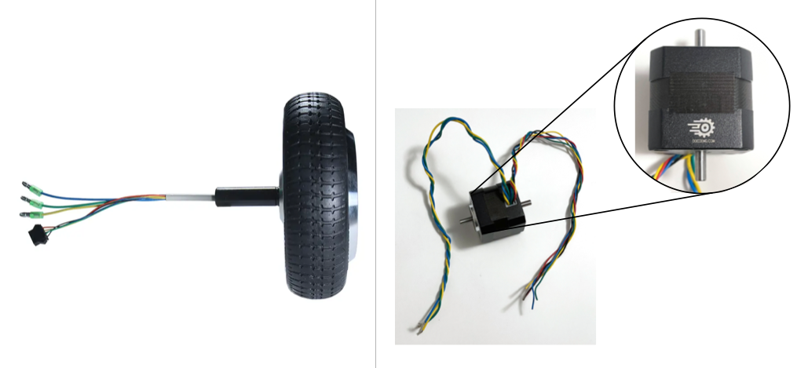

# P2-BLDC-Motor-Control

Single and two-motor BLDC drive objects, in Spin2/Pasm2, for the Parallax Propeller 2 (P2) and the Parallax 64010 Universal Motor Driver P2 Add-on Board

![Project Maintenance][maintenance-shield]

[![License][license-shield]](LICENSE)

```text
Latest Changes:
v6.2.0  The objects run at any system clock from 130 to 300 MHz; the DocoEng motor is
        characterized and verified on our hardware at six supply voltages; smoother
        slow-downs and stops from top speed.
v6.1.0  The drive holds its commanded speed under load, giving way only at its current limit.
v6.0.0  A reworked drive: lower current, a quiet start, built-in protection, and every
        command reporting its result.
```

The full history, and the known issues of the current release, are in the [CHANGELOG](CHANGELOG.md).

## Table of Contents

On this Page:

- [The Project](#the-project) - What these objects do, and the boards and motors they drive
- [What you need](#what-you-need) - The parts for a one-motor or a two-wheel setup
- [Getting started](#getting-started) - The pages to read, in order, to get your first motor turning
- [Your first run](#your-first-run) - Which demo to build first, and what it prints
- [The objects](#the-objects) - The steering object and the motor object, and how they divide the work
- [DEMOs](#demos) - Every demo, and the FlySky remote-control setup
- [Known Issues](#known-issues) - What does not work yet
- [Future directions](#future-directions) - Where we would like to take this next
- [How to Contribute](#how-to-contribute) - We welcome contributions back to this project
- [Credits](#credits) - The work this project is built on

Additional pages:

**Getting started**, in this order:

- [The motor driver boards](DRIVER_BOARDS.md) - Which Universal Motor Driver board you have (Rev A or Rev B), and what the driver does with each
- [Connecting the 6.5" motor](MOTOR-6.5IN-CONNECTING.md) - Wiring the 6.5" hub motor to the driver board
- [Connecting the DocoEng motor](DOCOENG_MOTOR.md) - Wiring the DocoEng 4,000 RPM motor to the driver board
- [Configuring the driver for your motor](MOTOR_CHOICE.md) - Choosing your motor, drive voltage and wheel size in the configuration file
- [Start your own drive project](DEVELOP.md) - Adding these objects to a program of your own, step by step

**Using the objects:**

- [Drive Objects](DRIVE-OBJECTS.md) - The public interface of the steering and motor objects
- [Serial control from a Raspberry Pi or Arduino](SERIAL-CONTROL.md) - Driving your platform from another computer over serial
- [Serial interface](DRIVE-OBJECTS-SERIAL.md) - The serial command set
- [Adding a battery voltage sensor](VOLTAGE-SENSOR.md) - A five-part sensor so your program can read the pack's voltage on one P2 pin
- [Platform drawings](DRAWINGS.md) - Files (.dwg) you can use to order your own platform inexpensively
- [To-scale drawings](DOCs/bot-layout.pdf) - Possible rectangular and round platforms for the Edge Mini Breakout and JonnyMac P2 boards

**The motors and the driver in depth:**

- [The 6.5" motor technical manual](MOTOR-6.5IN-TECHNICAL-MANUAL.md) - The 6.5" motor as measured: geometry, commutation, speed and current, stopping and holding
- [The DocoEng motor technical manual](MOTOR-DOCO-TECHNICAL-MANUAL.md) - The DocoEng motor as measured, section for section beside the 6.5" manual
- [Driver Theory of Operations](DRIVER-THEORY-OF-OPERATIONS.md) - How the driver works inside: its cogs, the Spin2/PASM2 contract, commutation, ramps, stops and protection
- [Adding support for a new motor](ADDING_MOTOR.md) - Characterize your motor and add it to the driver
- [Techniques](TECHNIQUES.md) - How we measured the motors and built the driver, written so you can reuse the methods

**Background:**

- [The 6.0 driver rework](DRIVER-6.0-REWORK.md) - Why the drive was reworked for v6.0.0, and how each change was checked
- [Movement API Study](Movement-STUDY.md) - The 2022 study of LEGO Mindstorms and BlocklyProp that shaped our public interfaces
- [The Author's test platform](AUTHORS-Platform.md) - The robot platform these objects were developed and tested on
- [Changelog](CHANGELOG.md) - What changed in each release, and the known issues of the current one

## The Project

Provide ready-to-use objects easily incorporated into your own code which control Brushless DC (BLDC) motors via the [Parallax 64010 Universal Motor Driver P2 Add-on Board](https://www.parallax.com/product/universal-motor-driver-p2-add-on-board/). One object drives a single motor; a second coordinates two motors as a two-wheel drive platform.

Two motors are supported:



**Figure 1**: *Left: the 6.5" hub motor, [SKU 27860](https://www.parallax.com/product/6-5-hub-motor-with-encoder/). Right: the DocoEng 4,000 RPM motor, [SKU 750-90020](https://www.parallax.com/product/motor-bldc-24v-4000-rpm/).*

Parallax offers a pair of the [6.5" hub motors along with mounting hardware](https://www.parallax.com/product/6-5-hub-motors-with-encoders-and-mounting-blocks-bundle/) for building a two-wheel platform. This post, [Build a Heavy-Duty Robot Using 6.5″ Hub Motors and Propeller 2 Control System](https://www.parallax.com/build-a-heavy-duty-robot-using-brushless-dc-motors/), describes our two-wheel system.

## What you need

| Part | For one motor | For a two-wheel platform |
| --- | --- | --- |
| A P2 board (see below) | 1 | 1 |
| [Parallax 64010 Universal Motor Driver P2 Add-on Board](https://www.parallax.com/product/universal-motor-driver-p2-add-on-board/) | 1 | 2, one per motor |
| A motor: the 6.5" hub motor or the DocoEng motor | 1 | 2 |
| A battery pack or bench supply at one of the supported drive voltages (6.0 to 24 V; see [Configuring the driver for your motor](MOTOR_CHOICE.md)) | 1 | 1 |
| Optional: the FlySky remote and SBUS receiver, for the remote-control demos | | 1 |
| Optional: the [battery voltage sensor](VOLTAGE-SENSOR.md) | 1 | 1 |

The driver board plugs onto any of these P2 boards:

| Board | Features |
| --- | --- |
| [Parallax 64029 P2 Edge Breakout Board](https://www.parallax.com/product/p2-edge-breakout-board/) | medium size, no solder-free prototyping area, 4 12-pin header pairs<br><br>(**Recommended for mobile platforms**, *unless you need the smaller Mini Breakout and do not need its extra pins*) |
| [Parallax 64019 P2 Edge Mini Breakout Board](https://www.parallax.com/product/p2-edge-mini-breakout-board/) | smaller, 2 12-pin header pairs plus an extra 12-pin header (partially used)<br><br>(**Alternate recommendation for mobile platforms**, *if you have less space and use fewer pins*) |
| [Parallax 64020 P2 Edge Module Breadboard](https://www.parallax.com/product/p2-edge-module-breadboard/) | larger size, solder-free prototyping area, 4 12-pin header pairs |
| [Parallax 64000 Propeller 2 Evaluation Board (Rev C)](https://www.parallax.com/product/propeller-2-evaluation-board-rev-c/) | medium size, no solder-free prototyping area, 4 12-pin header pairs |

**NOTE:** *If you plan to add more than a couple of sensors to your platform, use the 64029 P2 Edge Breakout Board: two driver boards take most of the pins on the smaller boards.*

## Getting started

Follow these pages in order to get your first motor turning:

1. **Know your driver board.** The Universal Motor Driver board comes in two revisions, Rev A and Rev B. The driver detects which one you have when it starts, and the two differ in how finely they measure current. [The motor driver boards](DRIVER_BOARDS.md) tells you which you have and what it means.
1. **Connect your motor.** [Connecting the 6.5" motor](MOTOR-6.5IN-CONNECTING.md) or [Connecting the DocoEng motor](DOCOENG_MOTOR.md).
1. **Configure the driver.** Choose your motor, drive voltage, pins and wheel size in **isp_bldc_motor_userconfig.spin2**: [Configuring the driver for your motor](MOTOR_CHOICE.md).
1. **Run a demo.** See [Your first run](#your-first-run) below.
1. **Write your own program.** [Start your own drive project](DEVELOP.md) walks through it, and [Drive Objects](DRIVE-OBJECTS.md) is the full interface.

If you would rather drive from a Raspberry Pi or an Arduino, the same first three steps apply, then head over to [Serial control](SERIAL-CONTROL.md).

## Your first run

Put your wheels up off the bench (or the motor where its shaft can turn freely) before the first run: each demo's wiring check turns the wheel a little one way and back.

- **One motor:** build and run **demo_single_motor.spin2**. Its configuration, as shipped, is the DocoEng motor on pins P16-P31 at 12 V; for the 6.5" motor or another voltage, change the single-motor section of **isp_bldc_motor_userconfig.spin2** first.
- **Two wheels:** build and run **demo_dual_motor.spin2**. Its configuration, as shipped, is two 6.5" motors, left on P16-P31 and right on P32-P47, at 18.5 V.

Each demo prints what it does as it goes: the start checks for each motor, the wiring check, then each drive and how it ended (`SR_AT_LIMIT` when a drive ends on its own limit), and finally `DONE`. If a start check fails, the demo tells you which one and why. [Start your own drive project](DEVELOP.md#checking-for-errors) explains each report.

That's all there is to it. Once a demo runs, you have everything working that your own program needs.

## The objects

There are two objects in our motor control system. There is a lower-level object (**isp_bldc_motor.spin2**) that controls a single motor, and there is an upper-level object (**isp_steering_2wheel.spin2**) which coordinates a pair of motors as a drive subsystem.

If you are working with a two-motor platform, you'll be coding to the interface of the steering object as you develop your drive algorithms. If you work with, say, a three-wheeled platform, you may want to create a steering object of your own that coordinates all three motors; base it on this project's two-wheel version. (*And if you do, please consider contributing your work to this project so it can be available to us all! See [How to Contribute](#how-to-contribute) below.*)

The drive uses 2 cogs for a single motor and 3 for a two-wheel platform; how they divide the work, and how your calls reach them, is described in [Objects and cogs](DRIVE-OBJECTS.md#objects-and-cogs). The interfaces of both objects are in [Drive Objects](DRIVE-OBJECTS.md).

Here's a quick diagram of how the objects and their cogs fit together:

```text
  your app cog
       │ command methods post a request; status methods read shared memory
       ▼
  ┌────────────────────────────────────────────┐
  │ isp_steering_2wheel   (Spin2 object)       │   ← no cog of its own; it holds
  │ with the left and right isp_bldc_motor     │     the request slots and both
  └──────────────────────┬─────────────────────┘     motor instances
                         │ request (hub)
  ╔══════════════════════▼═════════════════════╗
  ║ front cog (Spin2), 1 kHz                   ║   ← 1 cog: it runs both motor
  ║ requests · tracking · limits · protection  ║     instances' front routines
  ╚══════════╤═════════════════════╤═══════════╝
             │ commands (hub)      │ commands (hub)
  ╔══════════▼══════════╗ ╔════════▼════════════╗
  ║ PASM2 driver cog    ║ ║ PASM2 driver cog    ║   ← 1 cog per motor
  ║ left motor          ║ ║ right motor         ║
  ╚═════════════════════╝ ╚═════════════════════╝
```

**Figure 2**: *The steering and motor objects and the cogs they run, on a two-motor platform. A single motor is the same chain with `isp_bldc_motor` in place of the steering object and one driver cog.*

Basically, your application calls the objects; the objects run no cog of their own. Each command your application makes is handed to the one front cog, which writes the commands each motor's driver cog runs. Your top-level application runs in its own cog as well.

## DEMOs

Each demo also shows how to read what the drive reports:

- why `start()` refused a motor (`getHealth()`);
- why a drive ended (`getStopReason()`);
- what the drive handled on its own (`getEvent()`);
- the fault response in effect.

They print these in words through the small helper object [demo_drive_names.spin2](src/demo_drive_names.spin2), which you can reuse.

| Spin2 File Name(s) | Demonstration | Required Board |
| --- | --- | --- |
| [demo_single_motor.spin2](src/demo_single_motor.spin2) | Controlling a single motor: the start checks, the wiring check, then a time-limited drive forward and one in reverse. (Uses HDMI (DVI) to display live motor details.) | Any of the four P2 boards |
| [demo_dual_motor.spin2](src/demo_dual_motor.spin2) | Controlling a pair of motors with the two-wheel steering object: the start checks, the wiring check, a 1 ft drive, two steered drives, then each wheel alone | Any of the four P2 boards |
| [demo_dual_motor_hdmi.spin2](src/demo_dual_motor_hdmi.spin2) | The two-wheel steering object, with HDMI showing both motors' internal variables during one steady drive | Any of the three P2 boards with four 12-pin header pairs (**not the 64019 P2 Edge Mini Breakout Board**) |
| [demo_dual_motor_rc.spin2](src/demo_dual_motor_rc.spin2) | Driving the pair from our **FlySky remote and SBUS receiver** through the steering object; prints each event and stop as it happens, and re-arming the kill switch (SwD) acknowledges a protective stop | Any of the four P2 boards |
| [demo_dual_motor_rc_hdmi.spin2](src/demo_dual_motor_rc_hdmi.spin2) | The FlySky demo, with HDMI showing both motors' internal variables | Any of the three P2 boards with four 12-pin header pairs (**not the 64019 P2 Edge Mini Breakout Board**) |

**NOTE:** *Each demo is commented as a starting point for your own program; [Start your own drive project](DEVELOP.md) shows how to wire these objects into a project of your own. For driving from a Raspberry Pi over serial, see [Serial control](SERIAL-CONTROL.md).*

### Preparing to run the FlySky Demo

To run the FlySky remote-control demo you'll wire the FlySky SBUS receiver to your platform, and then learn what the controls on the transmitter do.

#### Wiring the FlySky Connection

*We used the* **Parallax 64019 P2 Edge Mini Breakout Board** *for our platform, and chose pin 58 for SBUS receive.*

The top-level file **demo_dual_motor_rc.spin2** defines the receive pin as 58, because the two motor driver boards occupy most of the remaining pins on the Mini Breakout board. Feel free to choose a different pin. Just remember to adjust the constants in your code to use your pin choice.

**P2 Wiring for the SBUS Receiver:**

| Receiver pin | P2 connection | Purpose |
| --- | --- | --- |
| GND | GND | Signal ground |
| Vcc | 5V | Power for the receiver |
| Rx | P58 | Data from the SBUS receiver to the P2 |

**NOTE:** *With the two driver boards occupying most of the pins, finding 5V was challenging. I ended up soldering in a pin between the two headers, routing 5V to it, and connecting the receiver's Vcc to this pin.*

#### FlySky Controls for the Demo

The remote-control demo uses the following controls:

| Control | Purpose |
| --- | --- |
| | **SWITCHES** |
| SwA | Motor control toggle: Up - disabled, Down - enabled |
| SwB | Show state: moving it Down prints both motors' current and power |
| SwC | Stop demo: Up - running, Middle - print the drive states, Down - exit the demo |
| SwD | Emergency cutoff: Up - disabled, Down - immediately stop the motors. Moving it back Up releases the emergency stop and any protective stop (a blocked wheel) |
| | **KNOBS** |
| VrA | Acceleration: the knob's travel sets `setAcceleration()` from 200 to 3000 mm/s^2; a new rate is sent only when the knob moves more than 10 mm/s^2, and always at either end |
| VrB | Deceleration: the knob's travel sets `setDeceleration()` from 1000 to 3000 mm/s^2 (from full speed, about 2 m to stop at the gentle end); sent as VrA's is |
| | **JOYSTICKS** |
| Left Joystick | Steering: Left - turn left (slow the left motor), Right - turn right (slow the right motor). Fully left or right stops that wheel and holds it, so the platform pivots about it |
| Right Joystick | Speed: Up - forward, Down - backward (centered is stopped, the extremes are fastest) |

## Known Issues

The known issues of the current release are listed with its entry in the [CHANGELOG](CHANGELOG.md).

**NOTE:** *Serial control has not been re-qualified on hardware for v6.2.0; it is planned for the next minor release.*

## Future directions

We kept a list of the improvements we would like to make next. Here are the most notable:

- Use the measured pack voltage in the drive, so power figures and speed limits follow a sagging pack
- A public query for whether each motor is keeping up with its command
- Support for platforms with more than two motors (such as the DocoEng motors driving a CNC)

If you have experience in these areas and want to help, please contact us in the Parallax Forums [(in this thread)](https://forums.parallax.com/discussion/174516/universal-motor-driver-dual-wheel-steering-motor-control-and-position-tracking-objects-for-p2#latest).

## How to Contribute

This is a project supporting our P2 Development Community. Please feel free to contribute to this project. You can contribute in the following ways:

- File **Feature Requests** or **Issues** (describing things you are seeing while using our code) at the [Project Issue Tracking Page](https://github.com/ironsheep/P2-BLDC-Motor-Control/issues)
- Fork this repo and then add your code to it. Finally, create a Pull Request to contribute your code back to this repository for inclusion with the projects code. See [CONTRIBUTING](CONTRIBUTING.md)

---

> If you like my work and/or this has helped you in some way then feel free to help me out for a couple of :coffee:'s or :pizza: slices!
>
> [](https://www.buymeacoffee.com/ironsheep) &nbsp;&nbsp; -OR- &nbsp;&nbsp; [](https://www.patreon.com/IronSheep?fan_landing=true)[Patreon.com/IronSheep](https://www.patreon.com/IronSheep?fan_landing=true)

---

## Credits

This work is based upon **Chip Gracey**'s **BLDC Motor Driver written in Pasm2**, which he demonstrated to us in many of our [live forums](https://www.youtube.com/playlist?list=PLt_MJJ1F_EXa25_TWa4Sdi77daQaxA_ZU). This project allows us all to use this driver. Thank you Chip!

The FlySky support and some of the serial support was written by **Jon McPhalen**. Thank you Jon!

## Disclaimer and Legal

> *Parallax, Propeller Spin, and the Parallax and Propeller Hat logos* are trademarks of Parallax Inc., dba Parallax Semiconductor

---

## License

Licensed under the MIT License.

Follow these links for more information:

### [Copyright](copyright) | [License](LICENSE)

[maintenance-shield]: https://img.shields.io/badge/maintainer-stephen%40ironsheep%2ebiz-blue.svg?style=for-the-badge

[license-shield]: https://img.shields.io/badge/License-MIT-yellow.svg
